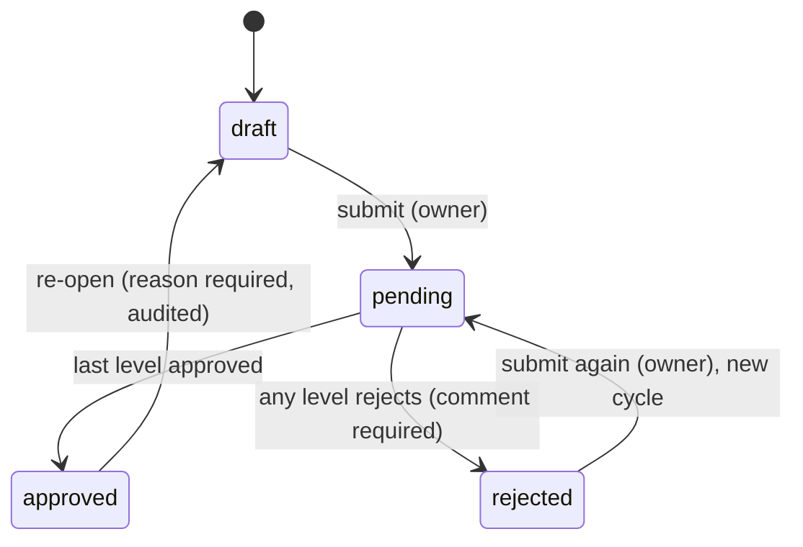

# Approval state machine and configuration guide

## States

A document (anything implementing `ApprovableDocument`) is in exactly one `approval_status`. Only
`ApprovalService` changes it; the columns are not mass-assignable and a client payload can never set them.



* **draft / rejected** — editable by users with the `edit` permission.
* **pending** — locked for everyone (no bypass, Super Admin included). Edits made behind the UI are detected by the
  fingerprint and block approval (see below).
* **approved** — locked and available to transactions, dropdowns and the API (`Model::approved()` / `usable()`).
  The only way to change an approved document is to **re-open** it (below).

## Re-opening an approved document

`ApprovalService::reopen($document, $user, $reason)` takes an **approved** document back to `draft` so it can be corrected
and approved again. It is deliberately visible:

* a reason is mandatory and is stored in the audit entry (`reopened`, with old and new status and the acting user);
* the earlier approval rows stay on record; the next submission is a new cycle;
* from the moment it is re-opened the document is no longer `approved()` / `usable()`, so it drops out of every
  transaction picker and lookup until it is approved again;
* the service guards only the state (approved → draft, once); **who may do it is the model policy's `reopen` ability**
  (for ledgers: `ledger.edit` plus the right to handle that ledger type, in the document's company).

Activating or deactivating an approved document is a different, lighter action (`changeStatus`): it changes availability,
not content, so it needs no re-approval and is not part of the fingerprint.

## Levels

Configured per company and document type at *Administration → Approval levels* (permission `setting.configure`).

| Setting | Meaning |
|---|---|
| No levels configured | One implicit level: the role the document type routes to by default (`defaultApproverRole()`: **items → Accounts**, per the company setting `approvals.item_approver`), or — when the type names none (ledgers) — anyone holding `{form}.approve` |
| Level approver | A **role** or one **specific user** (exactly one) |
| Mode | **Sequential** (default): level 2 becomes actionable after level 1 approves. **Parallel**: every level is actionable at once, in any order; all must approve |
| Decide within (hours) | Optional deadline. The clock starts when the level becomes actionable; stored as `due_at` for later escalation |

Mode and approvers are copied onto the approval rows at submission, so changing the configuration never alters a
document that is already waiting.

## Decisions

`submit` → rows are created for the new **cycle**. `approve` / `reject` act on a level the user may decide:

1. The user must be active and have access to the document's company.
2. They must be **designated** for the level (role, named user, or `{form}.approve` for the implicit level) — or hold
   the explicit **`approval.override`** permission. An override is recorded (`approvals.overridden = 1`, `override: true`
   in the audit entry). Notifications still go to the designated approvers only; override holders are not paged.
3. **Maker–checker** (company setting, on by default): nobody can approve a document they created or submitted — overrides
   included.
4. **Unchanged since submission**: the document is fingerprinted (sha256 of its content) when submitted. If it differs
   at approval time the approval is refused; the approver can *reject* it so the owner reviews and resubmits.
   Models whose content includes child rows override `approvalFingerprintParts()`.
5. Rejection requires a comment, marks the level rejected, cancels the levels still waiting, and returns the document
   to `rejected` (editable) with the reason on record.

Every decision keeps the actor, time, level and comment. History is never rewritten: resubmission starts a new
`cycle`, and the previous one stays visible in the approval panel.

## Events and notifications

| Event (after commit) | Fired when | Default listener |
|---|---|---|
| `ApprovalRequested` | a level becomes actionable (on submit; for the next level in sequential mode) | notify designated approvers (in-app + e-mail) |
| `DocumentApproved` | the last level approves — exactly once per submission | notify the submitter. Downstream modules listen here (e.g. Sales Order → Sales Invoice) |
| `DocumentRejected` | any level rejects | notify the submitter with the reason |

Listeners that create records must be idempotent: events can be redelivered.

## Using it in a module

```php
class Quotation extends TenantModel implements ApprovableDocument
{
    use Approvable, BelongsToLocation;

    public function approvalDocumentType(): DocumentType { return DocumentType::Quotation; }
    public function approvalUrl(): ?string { return route('quotations.show', $this); }
    // optional: route to a role when the company has configured no levels (null = anyone with the approve permission)
    public function defaultApproverRole(): ?string { return 'Accounts User'; }
    // optional: throw ApprovalStateException::notReady('…') to block submission
    public function beforeSubmitForApproval(): void { ... }
    // optional: include line items in what the approver signs off on
    protected function approvalFingerprintParts(): array { return [...parent::approvalFingerprintParts(), 'lines' => $this->lines->toArray()]; }
}
```

On the detail screen: `<livewire:shared.approval-panel type="quotation" :id="$quotation->id" />` and
`<livewire:shared.comments type="quotation" :id="$quotation->id" />`.

## Permissions involved

`{form}.approve`, `{form}.edit` (submit, and re-open when the policy allows), `approval.override` (explicit break-glass), `setting.configure` (chain
configuration). See [permission-matrix.md](permission-matrix.md).
