# Schema and relationship map (Phases 1–9)

Phase 1 (Foundation) tables are in the first diagram, Phase 2 (Masters) in the second, Phase 3 (Ledgers) in the third, Phase 4 (Items) in the fourth, Phase 5 (Rates) in the fifth, Phase 6 (field sales) in the sixth, Phases 7 (leads) and 8 (the API's two tables) after it.
Later phases add their own
tables to this map (CRM, Sales). All business tables carry `company_id`; branch-owned ones also carry `location_id`.

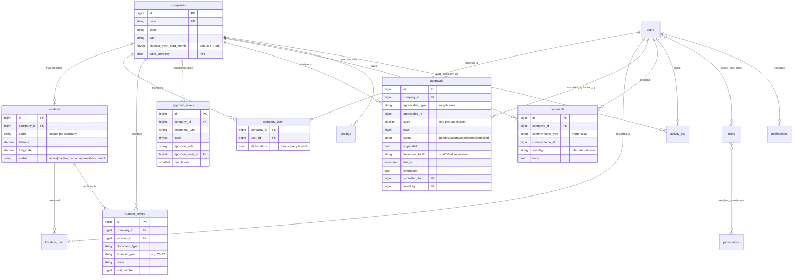

## Phase 2: Masters

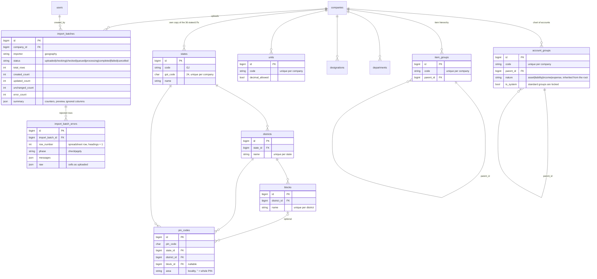

The plain masters (departments, designations, units, geography, account and item groups, branches) are **not**
approval documents: they have no `approval_status`. Ledgers and items (Phases 3–4) are.
Geography is per company: each company loads its own States → PIN codes (states are seeded from `StateCatalog`),
so one company's import can never change another's data. Districts, blocks and PIN rows have no natural code in the
source data, so they are keyed by name (the one documented exception to "a code on every master"). Import details:
[imports.md](imports.md).

## Phase 3: Ledgers

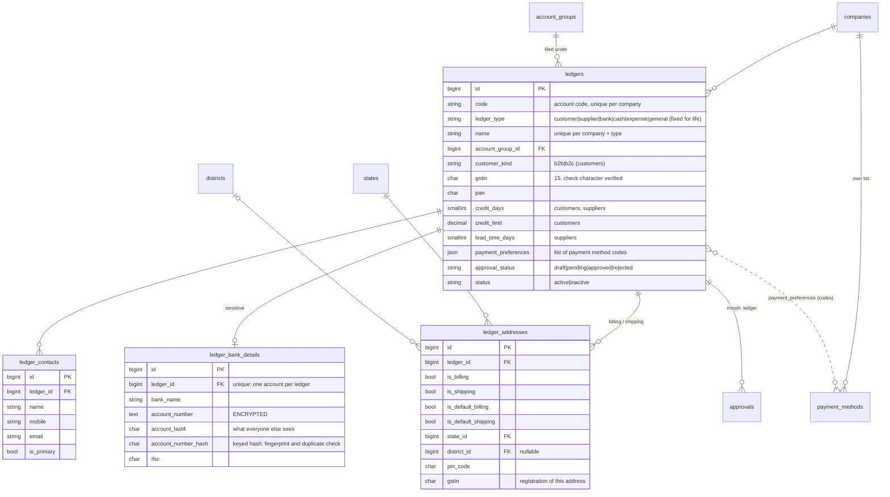

A ledger is the **party / account master**: it posts nothing and is not a double-entry ledger. Which part of the chart of
accounts a ledger may be filed under depends on its type (`LedgerType::groupRootCodes()`):

| Type | Filed under (the standard group or anything beneath it) |
|---|---|
| Customer | Sundry Debtors (1160) |
| Supplier | Sundry Creditors (2230) |
| Bank | Bank Accounts (1110) or Bank OD Accounts (2310) |
| Cash | Cash-in-Hand (1120) |
| Expense | Direct (4100), Indirect (4200) Expenses or Purchase Accounts (4300) |
| General | any group |

Addresses, contacts and the bank account are covered by the **ledger's own approval**: they are edited only while the
ledger is editable, and a change after submission blocks approval (the fingerprint includes them; for the bank account it
uses the keyed hash, never the number).

## Phase 4: Items

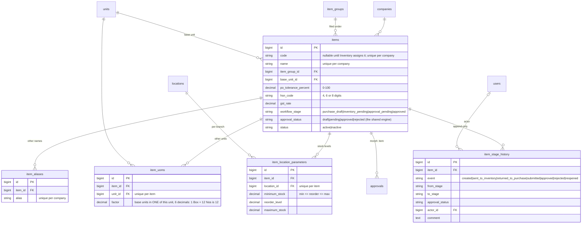

`workflow_stage` (whose turn it is) and `approval_status` (the approval engine's state) are kept consistent by the `Item` model,
whichever screen or service drives the engine: draft/rejected ↔ a work stage (Purchase or Inventory), pending ↔ awaiting
approval, approved ↔ approved. A stage that does not fit its status is refused (`LogicException`). Details and rules:
[items.md](items.md).

## Phase 5: Rates

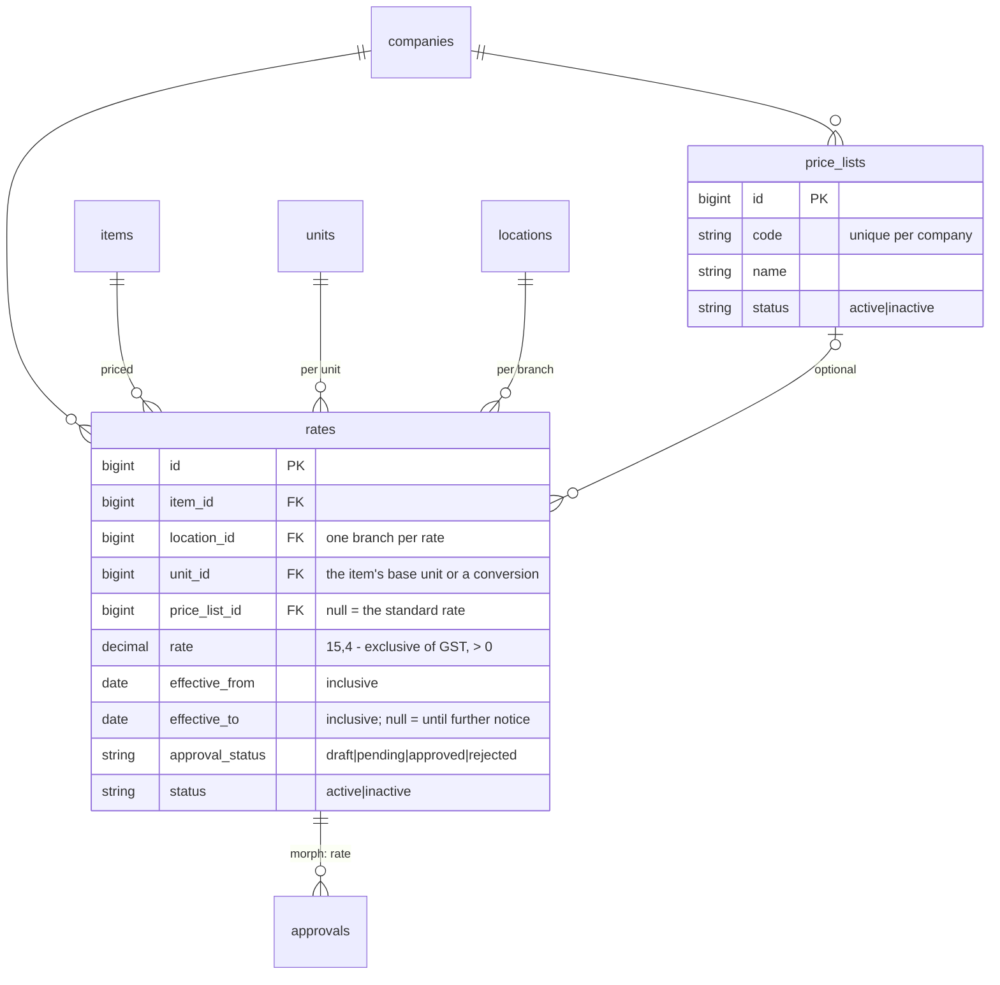

Only **approved, active** rates inside their period are ever returned to a transaction (`RateService`). Two pending or approved
rates for the same item, branch, unit and price list cannot overlap. Details: [rates.md](rates.md).

## Phase 6: Sales teams, targets, route plans, attendance

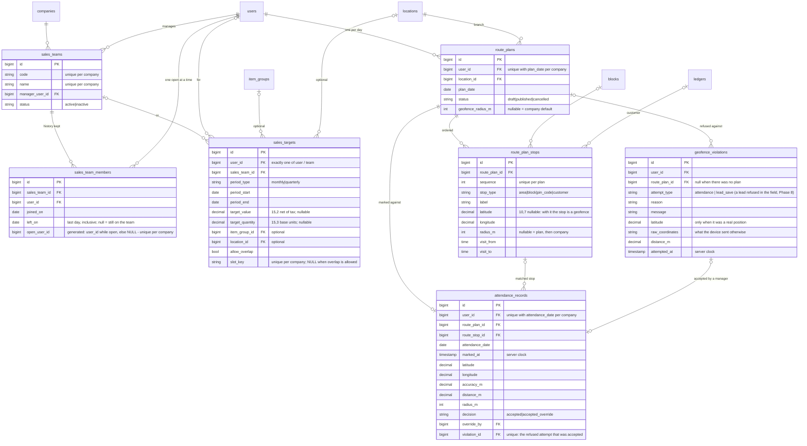

`attendance_records` and `geofence_violations` are **append-only** (the models refuse updates and deletes) and are not
soft-deleted. Details and rules: [field-sales.md](field-sales.md).

## Phase 7: Leads and follow-ups

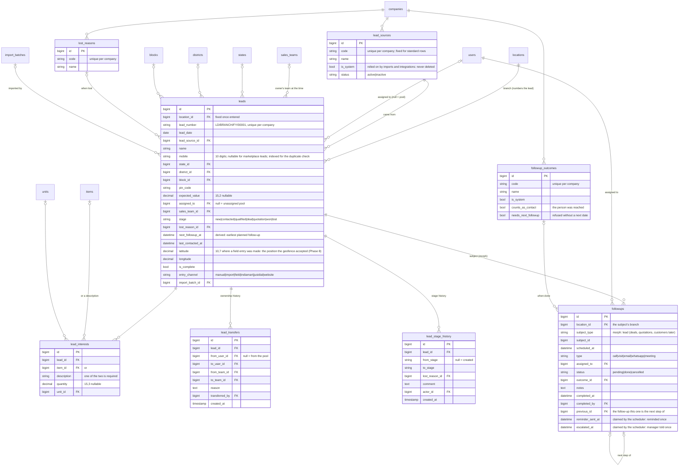

`lead_transfers` and `lead_stage_history` are **append-only** (the models refuse updates and deletes). A lead has no
active/inactive `status` (its stage says where it stands) and is not an approval document. A follow-up is never deleted: it
is done or called off. Details and rules: [leads.md](leads.md).

## Phase 8: Mobile API (devices and idempotency keys)

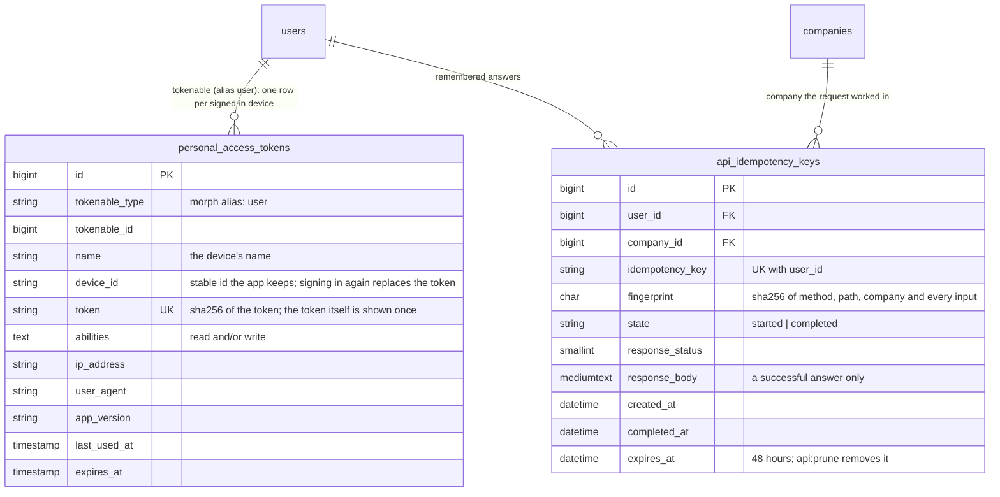

A device token is not company data (a person may belong to several companies), so `personal_access_tokens` has no
`company_id`; issuing and revoking one is written to the audit log under the person's own company. `api_idempotency_keys`
holds copies of what an answer contained, for 48 hours, and is pruned daily. Nothing else changed: attendance, the violation
log and leads already had the columns the API needs (`attempt_type`, `source`, a lead's `latitude`/`longitude`).
Rules and use: [api.md](api.md).
## Phase 9: Lead marketplaces (IndiaMART, Just Dial)

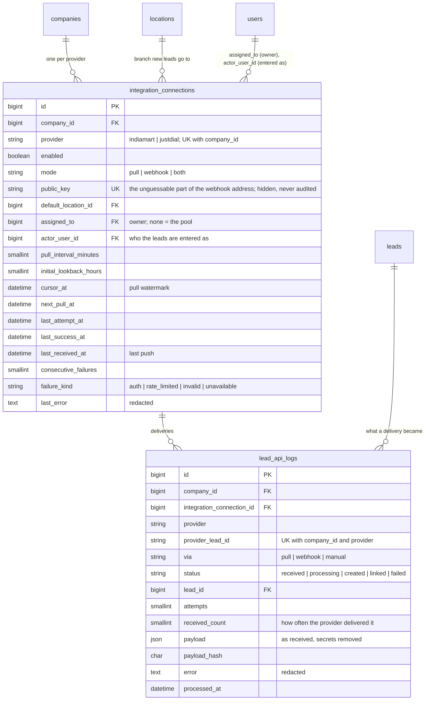

A connection holds **no secret**: the provider's API key and the webhook signing secret are company settings (encrypted, write-only), and
the sync bookkeeping (`cursor_at`, `last_*`, `consecutive_failures`, `last_error`) and `public_key` are kept out of the audit log.
`lead_api_logs` is the dead-letter queue: a `failed` row keeps its payload and is retried by hand; rows are pruned after the retention
period (`integrations.log_retention_days`, 90 days; failed ones twice that). Rules and use: [integrations.md](integrations.md).

## Phase 10: Inquiries from existing customers, and deals

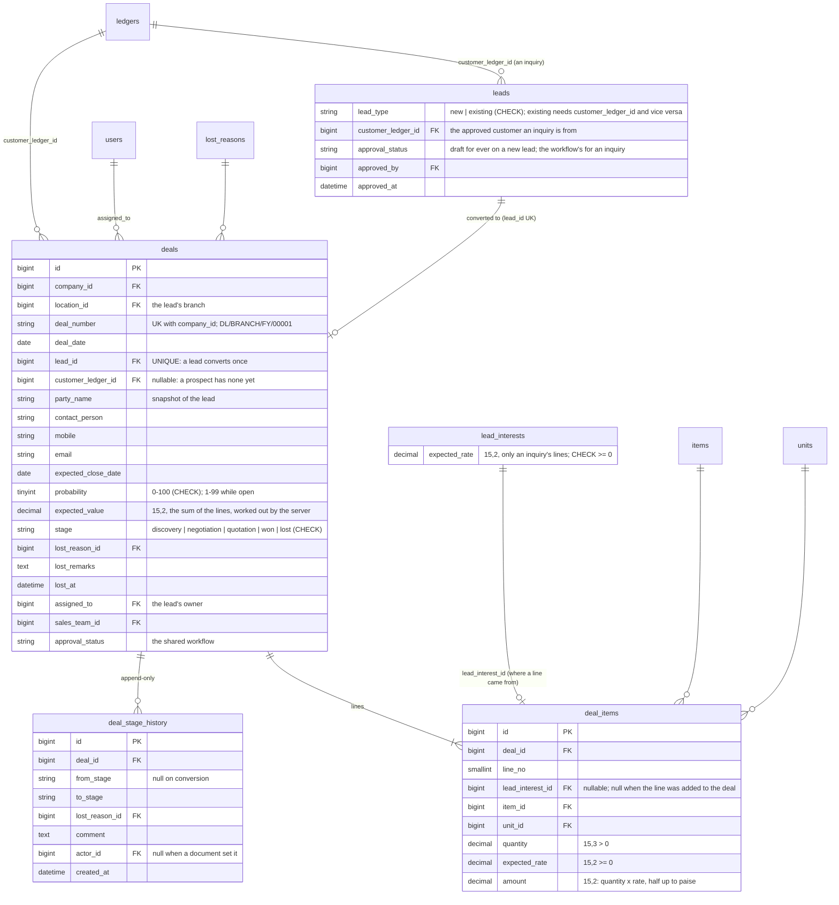

An inquiry from an existing customer is a row of `leads` (so follow-ups, hand-overs, access and the API are shared) that names its customer and
carries the approval columns. A deal has its own numbered, approvable row and lines; it keeps the link to the lead and to each lead line
it came from. The approval fingerprint of a deal covers its customer and lines (not its stage, probability or close date); an inquiry's covers
its customer, source, requirement and lines. Rules and use: [deals.md](deals.md).

## Uniqueness and integrity rules

| Rule | Where |
|---|---|
| A lead number is unique within a company and never reused | `unique(company_id, lead_number)`; issued by `NumberSeriesService` in the saving transaction; leads are soft-deleted |
| An open lead with the same mobile number is a duplicate: warned about, saved only when the person says so | `LeadService` (company-wide, across branches); `index(company_id, mobile)` |
| A lead's branch never changes; its owner changes only through a transfer | `LeadService::update()` ignores both; `LeadTransferService` |
| A lead is moved by hand only between New, Contacted and Qualified; Lost needs a reason, re-opening a comment; Deal / Quotation / Won are set by a conversion | `LeadStage::canMoveTo()`, `LeadService::changeStage()` under a row lock |
| An interest names an item or describes one; a lead's coordinates come as a pair; an expected value is not negative | `CHECK` constraints on `lead_interests` and `leads` |
| An interest's item is approved and active when chosen, and its unit is one the item is sold in | `LeadService` through `ItemLookup` |
| A lead is new or an inquiry from a customer, never half of each; an inquiry's rate is not negative | `CHECK` constraints `leads_type_valid`, `leads_inquiry_names_customer`, `lead_interests_rate_valid` |
| A lead converts to a deal once, however many people try at once | `unique(lead_id)` on `deals` **and** the lead's row lock with a locking read of the deal in `DealService::convert()`; proven by `tests/Concurrency/DealConcurrencyTest.php` (five deals with neither, one with either) |
| A deal number is unique within a company and never reused; deals are never deleted | `unique(company_id, deal_number)`, taken from `NumberSeriesService` first in the saving transaction; `DealPolicy::delete()` is false |
| A deal's probability is 0–100, its value and amounts are not negative, its stage is one of five, a line has a quantity | `CHECK` constraints on `deals` and `deal_items` |
| Every line of the lead comes across to its deal; a line's item is an approved, active item in a unit it is sold in, a whole quantity for a unit that cannot be split | `DealService::validate()` |
| A deal's value and each amount are worked out on the server, half up to paise | `DealService` (never read from the request) |
| A deal's customer and lines change only while it is a draft or returned; an approved deal is re-opened with a reason | `Deal::isContentEditable()`, `DealService::update()` under a row lock; `ApprovalService::reopen()` |
| A deal's stage history is never changed or deleted | model `updating` / `deleting` guards on `DealStageEntry` |
| A lead's stage follows its deal (Deal, Quotation, Won, Lost) | `DealService` through `LeadService::setStageBySystem()` |
| A hand-over moves every selected lead or none; two at the same instant are serialised | `LeadTransferService` (row locks, one transaction) |
| Stage history and ownership history are never changed or deleted | model `updating` / `deleting` guards on `LeadStageEntry`, `LeadTransfer` |
| A follow-up is finished once (and plans its next step once) | `FollowupService` under a row lock |
| A reminder, and an escalation, is sent once per follow-up | conditional `UPDATE … WHERE reminder_sent_at IS NULL` (and `escalated_at`) before anything is sent |
| A standard lead source or outcome keeps its code and is never deleted; one in use is never deleted | `KeepsSystemCodes`, `CrmMasterPolicy`, the list screens' usage checks |
| The first number of a series is issued without a deadlock even inside the document's own transaction | `NumberSeriesService::lockSeries()` (plain read, then `INSERT … ON DUPLICATE KEY UPDATE`, and no second lock request by the creator) |
| A company has one connection per provider | `unique(company_id, provider)` on `integration_connections`; the address key is unique too |
| The same provider lead is one delivery however often it arrives | `unique(company_id, provider, provider_lead_id)` on `lead_api_logs`; `received_count` counts the repeats; proven by `tests/Concurrency/WebhookConcurrencyTest.php` (five leads without it, one with it) |
| One lead per buyer when several enquiries from one mobile number arrive together | `LeadIntake` takes a cache lock on the number around "find the open lead, else create"; proven by the same race test (five leads without the lock) |
| Two workers never take the same delivery; one that died holding it loses it after ten minutes | one conditional UPDATE `received/failed → processing` (or stale `processing`) in `LeadIntake::claim()` |
| IndiaMART is never called more often than it allows | one conditional UPDATE of `last_attempt_at` against the provider's minimum gap in `ProviderSync` || A device token is stored only as a hash; one token per device id; at most `API_MAX_DEVICES` per person | `unique(token)`; `DeviceTokenService` (replaces the same device, signs out the least recently used beyond the limit) |
| The same Idempotency-Key never runs two requests: the database lets exactly one in | `unique(user_id, idempotency_key)` on `api_idempotency_keys`; proven by `tests/Concurrency/ApiIdempotencyConcurrencyTest.php` (five leads without it, one with it) |
| A lead saved from the field is saved only when its position is inside today's published plan's geofence, and its branch is the plan's | `FieldLeadService` through `FieldPositionGate`; a refusal is a `lead_save` row in `geofence_violations` || A person has one open team membership per company, and memberships never overlap in time | generated column + `unique(company_id, open_user_id)` on `sales_team_members`; `SalesTeamService` |
| A target is for a person or a team, never both or neither; it has a positive value and/or quantity; its period does not end before it starts | database `CHECK` constraints on `sales_targets` |
| Two targets for the same person/team, item group and branch do not cover the same days unless one allows overlap | `TargetService` under a lock on the person or team; `unique(company_id, slot_key)` for exact duplicates |
| One route plan per person and day | `unique(company_id, user_id, plan_date)` |
| A stop's coordinates come as a pair and are a real position; stops keep a unique order within a plan | `CHECK` constraints and `unique(route_plan_id, sequence)` on `route_plan_stops`; `RoutePlanService` |
| One attendance per person and day; a refused attempt is accepted at most once | `unique(company_id, user_id, attendance_date)`, `unique(violation_id)` on `attendance_records` |
| Attendance and the violation log are never changed or deleted | model `updating` / `deleting` guards |
| An item's name is unique within a company; its code too, but items without a code yet never clash | `unique(company_id, name)`, `unique(company_id, code)` (NULLs do not collide) |
| An item has one conversion per alternative unit; an alias is unique within the company; one stock row per item and branch | `unique(item_id, unit_id)`, `unique(company_id, alias)`, `unique(item_id, location_id)` |
| `minimum ≤ reorder level ≤ maximum`; whole numbers when the base unit cannot be split | `ItemService` |
| A conversion factor is positive, ≤ 6 decimals, and a whole number when the base unit cannot be split | `ItemService` |
| An approved item's code, base unit and existing conversions are frozen | `ItemService` |
| Stage and approval status must agree | `Item` model (`saving`) |
| Stage history is append-only | `ItemStageEntry` model hooks |
| A price list code is unique within a company | `unique(company_id, code)` on `price_lists` |
| A rate's period never ends before it starts; a rate is more than zero | database `CHECK` constraints `rates_period_valid`, `rates_rate_positive` |
| Live (pending or approved) rates for one item, branch, unit and price list do not overlap | `Rate::conflicting()` on save, and again under a lock on the item at submit |
| The unit of a rate is the item's base unit or a conversion; who and where an approved rate is for is fixed | `RateMaintenance` |
| A ledger name is unique within a company **and type**; a party may be both a customer and a supplier | `unique(company_id, ledger_type, name)` on `ledgers` |
| A GSTIN is used by one ledger per type | validation in `LedgerService` (a deleted ledger frees its GSTIN) |
| A ledger can only be filed under a group that belongs to its type and company | `LedgerService` (and `ValidatesParentCompany` on the model) |
| A ledger's type never changes | model `updating` guard |
| One default billing and one default shipping address | `LedgerService` (a lone address becomes the default) |
| One bank account per ledger; its number is encrypted and never audited | `unique(ledger_id)`; `encrypted` cast; excluded from the audit log |
| Groups that hold ledgers (or whose sub-groups do) cannot be deleted or moved | `AccountGroupTree` |
| Payment method codes in use cannot be renamed or deleted | `PaymentMethodList` |
| A code is unique within a company | `unique(company_id, code)` from the `masterColumns()` macro |
| A GST state code is unique within a company | `unique(company_id, gst_code)` on `states` |
| A district name is unique within a state, a block name within a district | `unique(company_id, state_id, name)`, `unique(company_id, district_id, name)` |
| A PIN row is PIN + district + locality | `unique(company_id, pin_code, district_id, area)`; `area` is NOT NULL (`''` = whole PIN) so the key is real, not defeated by NULLs |
| A child may only point at a parent of its own company | `ValidatesParentCompany` model guard on `account_groups`, `item_groups`, `districts`, `blocks`, `pin_codes` (plus form validation) |
| Account group tree: no cycles, same-nature moves only, standard groups locked | `AccountGroupTree` + `Hierarchy::wouldCreateCycle` |
| One counter per company + branch + document type + financial year | `unique(company_id, location_id, document_type, financial_year)` on `number_series` (branch is NOT NULL so the key really is unique) |
| One membership row per user and company | primary key on `company_user` |
| One approval level per company, document type and level | `unique(company_id, document_type, level)` |
| Settings: one value per company and key | `unique(company_id, key)` |

Deletes: master and document tables use soft deletes; `companies`, `locations` and the approval ledger are never
cascade-deleted from their owners (`restrictOnDelete`). Approval rows and audit entries are append-only.

## Column conventions (`Blueprint::masterColumns()`)

`company_id`, `code`, `status` (`active|inactive`), `approval_status` (`draft|pending|approved|rejected`),
`approved_by`, `approved_at`, `remarks`, `created_by`, `updated_by`, timestamps, soft deletes.
`companies` opts out of `company_id` and the approval columns (it is the tenant root); other tables opt out of
irrelevant columns with the macro's flags rather than carrying fields they never use.
Money is `decimal(15,2)` (`amount()` macro) and quantity `decimal(15,3)` (`quantity()` macro); a unit rate is the one exception, `decimal(15,4)`, because a price per piece can need four places.

## Polymorphic aliases (enforced morph map)

Shared: `user`, `company`, `location`, `number_series`, `approval`, `approval_level`, `comment`, `import_batch`, `role`,
`permission`. Masters (registered in `MastersServiceProvider`): `department`, `designation`, `unit`, `account_group`,
`item_group`, `state`, `district`, `block`, `pin_code`, `payment_method`, `ledger`, `ledger_address`, `ledger_contact`,
`ledger_bank_detail`, `item`, `item_uom`, `item_alias`, `item_location_parameter`, `item_stage_entry`, `price_list`, `rate`. CRM (registered in `CRMServiceProvider`): `sales_team`, `sales_team_member`, `sales_target`, `route_plan`, `route_stop`, `attendance`, `geofence_violation`, `lead_source`, `followup_outcome`, `lost_reason`, `lead`, `lead_interest`, `lead_transfer`, `lead_stage_entry`, `followup`, `deal`, `deal_item`, `deal_stage_entry`. Integrations (registered in `IntegrationsServiceProvider`): `integration_connection`. Sales (registered in `SalesServiceProvider`): `quotation`, `quotation_item`, `quotation_state_entry`, `quotation_dispatch`, `sales_order`, `sales_order_item`, `sales_order_state_entry`, `sales_invoice`, `sales_invoice_item`, `report_export`, `task`, `task_assignment`, `sla_policy`, `holiday`, `sla_clock`, `sla_breach`, `task_attachment`. Marketing (registered in `MarketingServiceProvider`): `campaign`, `campaign_step`, `campaign_member`, `message_template`, `communication`, `contact_consent`, `workflow`, `workflow_version`, `workflow_run`. Later modules register theirs the same way; an unregistered
model throws instead of writing a class name into the database.

## Quotations (Phase 11)

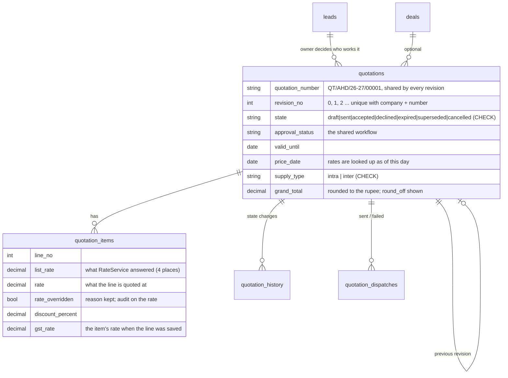

* A revision is a row; `previous_id` points at the one before it. `deal_id` is null for a quotation made straight from an inquiry;
  `lead_id` is always set and is what decides who owns the quotation.
* Customer, address, place of supply, supplier state and GSTIN, terms and every amount are **copies** made when the draft is saved.
* `quotation_history` and `quotation_dispatches` are append-only (models refuse update and delete).

| Rule | Enforced by |
|---|---|
| A revision number is used once per quotation | `unique(company_id, quotation_number, revision_no)` + the row lock in `QuotationService::revise()` |
| A revision that has left draft never changes (content, lines, delete) | `Quotation` / `QuotationItem` model guards; `QuotationService` |
| Only a draft that is approved, latest and still valid is sent; the claim is atomic | `QuotationService::send()` (locked draft → sent, then the e-mail; a refusal puts it back) |
| Prices come only from the rate master; a changed rate needs `rate.override`, a reason and leaves an audit entry on the rate | `QuotationPricer` → `RateService` |
| GST by place of supply, half-up paise, rupee round-off | `TaxService` (unit-tested) |
| A deal is in Quotation while a quotation of it is sent or accepted, otherwise back in Negotiation | `QuotationService::syncSourceStage()` through `DealService::setStageBySystem()` |
| A quotation may become an order only if latest, approved, sent/accepted and in date (exception audited) | `QuotationConversionGuard` |
| A warning is sent once | `WHERE expiry_warned_at IS NULL` claim in `QuotationExpiry` |

## Sales orders and sales invoices (Phase 12)

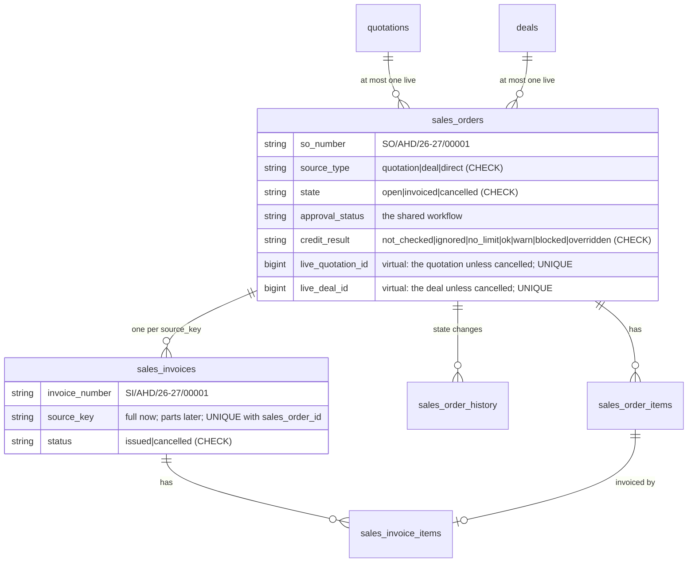

* An order and an invoice carry **copies** of the customer, both addresses, the place of supply, the supplier, the terms and every figure.
* `sales_order_items.invoiced_quantity` and `sales_invoice_items.sales_order_item_id` (unique per invoice) are what invoicing in parts will build on.
* `sales_order_history` is append-only (the model refuses update and delete).

| Rule | Enforced by |
|---|---|
| A quotation, and a deal, have at most one live (not cancelled) order | row lock on the source + a locking read in `SalesOrderService`, and `unique(live_quotation_id)` / `unique(live_deal_id)` on virtual columns |
| An order that is waiting, approved, invoiced or cancelled does not change (content, lines, delete) | `SalesOrder` / `SalesOrderItem` model guards; `SalesOrderService` |
| An approved order has exactly one full invoice, however often it is asked for or raced | `InvoiceGenerator` (number first, order row lock, locking existence read, rollback gives the number back) and `unique(sales_order_id, source_key)` |
| An issued invoice and its lines never change; only its status moves, with its order | `SalesInvoice` / `SalesInvoiceItem` model guards |
| An order over a blocking credit limit cannot be sent for approval without an audited override | `SalesOrder::beforeSubmitForApproval()` through `CreditCheck`; `SalesOrderService::overrideCredit()` |
| A direct order needs a regular customer, in a branch the person works in | `SalesOrderService::createDirect()` |
| A target counts approved, uncancelled orders on their order date, net of tax, for the salesperson credited | `SalesOrderAchievement` |

## Report exports (Phase 13)

`report_exports` is the only table of the phase: one row for each asked-for export (`company_id`, `user_id`, `report` key, `format` xlsx|pdf, `status`
queued|running|ready|failed|expired, the `filters` as asked, `file_path` on the private disk, `row_count`, `expires_at`). Status and format are
CHECK-constrained; the company, user, report and format cannot be changed once asked for (the model refuses); a file is deleted after 7 days and the row
stays as "expired". Reports and the dashboard read the other modules' tables and write nothing.

## Tasks and SLAs (Phase 14)

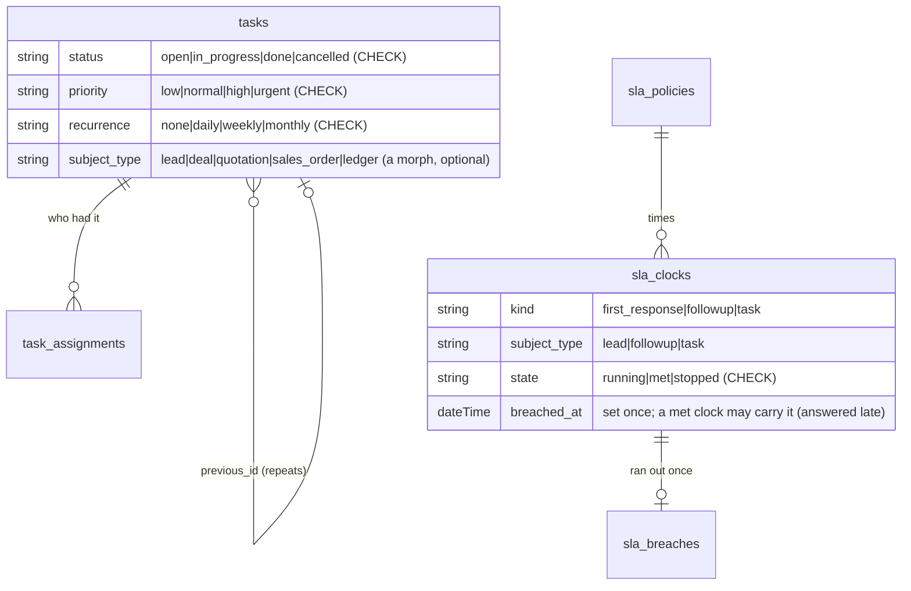

| Rule | Enforced by |
|---|---|
| A finished or called-off task never changes | `TaskService::live()` (locks the row, refuses) and `TaskPolicy` |
| Every giving of a task is kept | `task_assignments`, append-only (the model refuses update and delete) |
| A thing has one clock for a given start moment | `SlaSweep::open()` (policy row lock + re-check) |
| A breach is recorded once and announced once | the conditional `UPDATE … WHERE state='running' AND breached_at IS NULL` that claims it, and `unique(sla_clock_id)` on `sla_breaches` |
| The breach log and the clocks are records | `SlaBreach` is append-only; `SlaClock` cannot be deleted |
| A task reminder / overdue notice goes out once | `UPDATE … WHERE reminder_sent_at IS NULL` (and `overdue_notified_at`) in `tasks:remind` |

## Phase 14 gap closure (migration `2026_10_26_100000_workspace_gaps`)

`sla_clocks` gains `paused_at`, `paused_minutes`, `pause_reason`; `kind` on `sla_policies`, `sla_clocks` and `sla_breaches` widens to VARCHAR(20) and the
policy check allows `quotation_response` and `approval`; `task_attachments` (private files on a task: name, storage path, sniffed MIME, size, uploader,
`removed_at`/`removed_by` — a removed file is marked, not erased from the record).

## Campaigns, consent and workflows (Phase 15, migration `2026_10_27_100000_create_marketing_tables`)

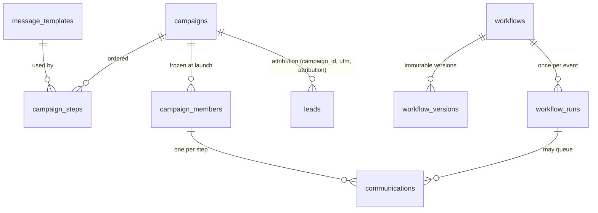

| Rule | Enforced by |
|---|---|
| A step is made once for a member, whatever runs | `unique(company_id, idempotency_key)` on `communications` (`c{campaign}:m{member}:s{step}`) and the conditional UPDATE that moves the member on |
| A workflow runs once per event | `unique(workflow_id, trigger_key)` on `workflow_runs`, claimed before any action |
| The approved steps of a campaign do not change | the `CampaignStep` model guard (reads the campaign's status) |
| Consent is history, never edited | `contact_consents` is append-only; the newest event per channel and address wins |
| A workflow version never changes | `WorkflowVersion` refuses update and delete; a change is a new version |
| A sent message is kept as it went out | the rendered subject and body are stored on `communications` |
| Marketing e-mail needs an opt-out | the template cannot be saved without `{{unsubscribe_url}}`; the signed link's GET changes nothing, POST records the opt-out |

## Brands and industry templates (Loss Intelligence L1, migration `2026_10_28_100000_create_brand_and_industry_template_tables`)

See [loss-intelligence.md](loss-intelligence.md) for why. `brands` is a plain company master. The `industry_templates` family is **system data**
(no `company_id`) shared by every company; only `company_industry_templates` and `industry_settings` belong to a company.

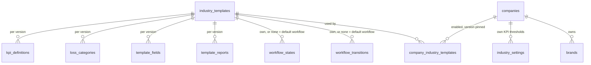

| Rule | Enforced by |
|---|---|
| A company never edits the shared template rows | no route or service writes them; the policy refuses create/update/delete; a company's choices live in `industry_settings` |
| A company on version 1 keeps seeing version 1 | every child row carries `version`; `company_industry_templates.version_pinned` selects it; `publishNewVersion()` copies forward |
| One row per template, version and code | `unique(industry_template_id, version, code)` on KPIs, categories, fields and reports |
| One enablement per company and template | `unique(company_id, industry_template_id)` |
| The default workflow serves templates without their own | rows with `industry_template_id` NULL; matched by hand in the seeder because a unique key never matches NULL |
| Brand code unique per company | `unique(company_id, code)` from `masterColumns()` |

## Returns, credit notes and item costs (Loss Intelligence L2, migration `2026_10_29_100000_create_sales_returns_and_item_costs`)

See [returns-and-costs.md](returns-and-costs.md). `items` gains `brand_id` (→ `brands`) and `standard_cost` (per base unit, 18,4). `sales_invoice_items` gains
`unit_cost`, `cost_amount`, `cost_source` (copied when the invoice is made; null = unknown).

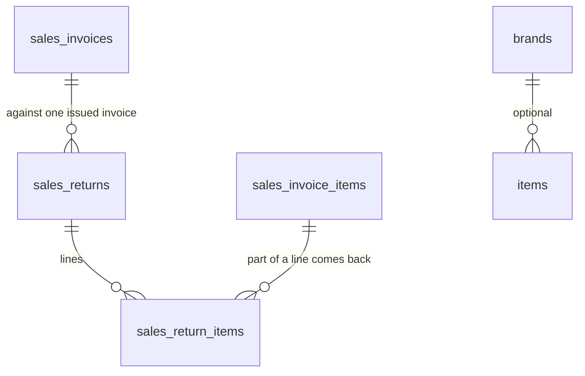

| Rule | Enforced by |
|---|---|
| A return line is part of exactly one invoice line, once per return | `unique(sales_return_id, sales_invoice_item_id)` |
| A return never takes more than the invoice line allows | `SalesReturnService::preview()` at save, and `problemBeforeSubmit()` under a lock on the invoice at submission |
| Pending and approved returns, and their lines, never change | `SalesReturn` / `SalesReturnItem` model guards (read the stored approval status) |
| A return is never deleted | model refuses |
| Return numbers are unique per company | `unique(company_id, return_number)` |
| Type and supply are known values; amounts are not negative | CHECK constraints on `sales_returns` / `sales_return_items` |

## Inventory and procurement (Loss Intelligence L3, migration `2026_10_30_100000_create_inventory_and_procurement_tables`)

See [inventory-and-procurement.md](inventory-and-procurement.md). `items` gains `tracking` (none | batch), `has_expiry`, `shelf_life_days`.

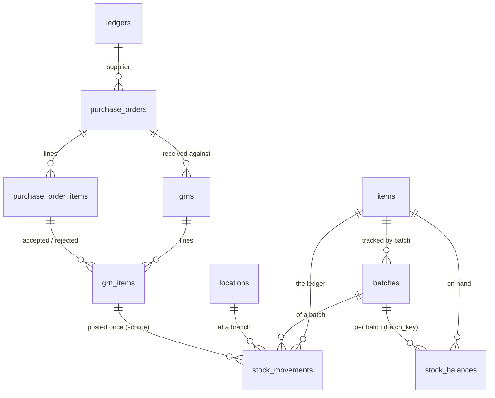

| Rule | Enforced by |
|---|---|
| A movement is never changed or removed | `StockMovement` model guards |
| A document line posts a kind of movement once | `unique(company_id, source_type, source_id, source_line_id, movement_type)` + the poster's re-check under the receipt's row lock |
| One balance row per branch, item and batch | `unique(company_id, location_id, item_id, batch_key)`; `batch_key` 0 = no batch (a NULL could not be unique) |
| Stock never negative | `StockService` refuses, and `CHECK (quantity >= 0)` on `stock_balances` |
| Balances agree with the ledger | written in the same transaction under the balance row's lock (taken by INSERT … ON DUPLICATE KEY UPDATE, never INSERT IGNORE + FOR UPDATE: that deadlocks); `stock:rebuild-balances` checks |
| One batch number per item | `unique(company_id, item_id, batch_no)` |
| A receipt line is one order line once | `unique(grn_id, purchase_order_item_id)` |
| Pending / approved orders and receipts, and their lines, never change | model guards on `PurchaseOrder`, `PurchaseOrderItem`, `Grn`, `GrnItem` |
| Quantities are sensible | CHECKs on `purchase_order_items` and `grn_items` (accepted + rejected > 0) |

## Loss management (Loss Intelligence L4, migration `2026_10_31_100000_create_loss_management_tables`)

See [loss-management.md](loss-management.md).

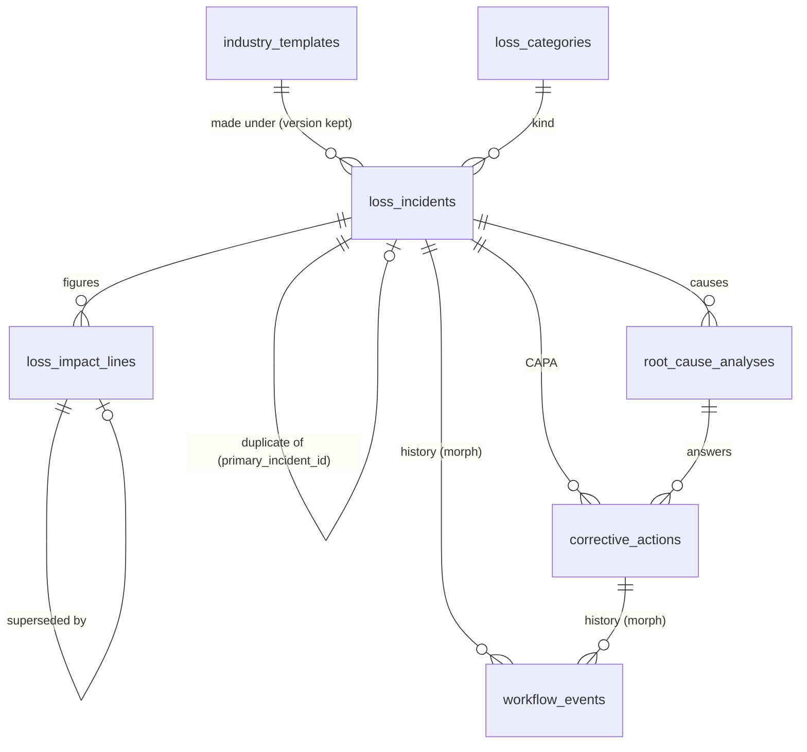

| Rule | Enforced by |
|---|---|
| A state changes only through the workflow | `LossWorkflowService::transition()` (transitions of the incident's template version, permissions, comments, approval, conditions) |
| Workflow history is never changed | `WorkflowEvent` model guards |
| A figure's amount never changes; a figure is never deleted | `LossImpactLine` guards (only validation and supersession columns move) |
| Kinds and states are known values; a figure is not negative; confidence 0–100 | CHECK constraints |
| A record reported twice is counted once | `primary_incident_id` set at creation (under a lock); `LossFigures` excludes duplicates |
| Numbers unique per company | `unique(company_id, incident_number)`, `unique(company_id, action_number)` |

## Finance and costing (Loss Intelligence L5, migration `2026_11_01_100000_create_finance_tables`)

See [finance.md](finance.md). `loss_incidents` gains `cost_center_id`.

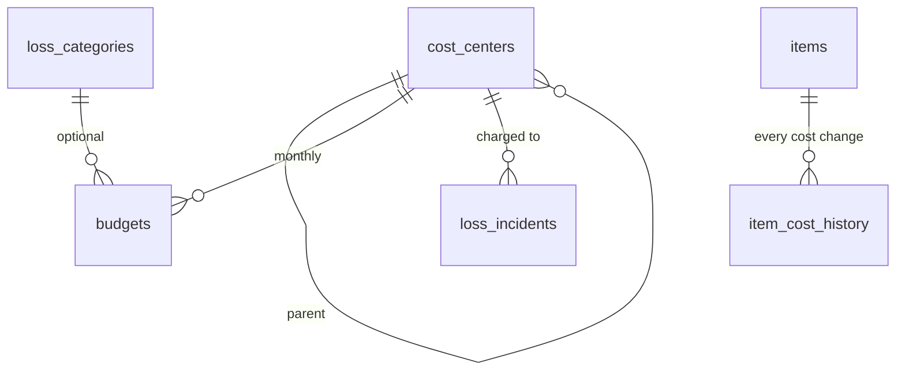

| Rule | Enforced by |
|---|---|
| One budget per cost centre, category and month | `unique(company_id, cost_center_id, category_key, period_start)` — `category_key` is a generated `COALESCE(loss_category_id, 0)` so "no category" is unique too |
| A pending or approved budget never changes | `Budget` model guard |
| Cost history is never changed or removed | `ItemCostEntry` model guards |
| A budget is not negative | CHECK on `budgets` |

## L6 additions

* `items.industry_template_id` (nullable FK → `industry_templates`): the industry an item belongs to; revenue by industry follows it.
* `kpi_snapshots`: company, `location_key` (0 = whole company), industry template, KPI definition + version, `period_type` (`day`), `period_start`, value / numerator / denominator (decimal 18,4, nullable), source freshness, computed at; unique `kpi_snapshot_once` (company, location, KPI, period type, period start).

## P1 (production) additions

* `boms` (approval master: `code` unique per company, `item_id`, `output_quantity`), `bom_items` (unique bill + line, unique bill + component, `scrap_percent`).
* `production_orders` (branch, `order_number` unique, `bom_id`, `item_id`, `planned_quantity`, dates, `state`), `production_components` (what the order requires, copied from the bill).
* `production_issues` and `production_outputs` (append-only; `unique(production_order_id, entry_key)`); the stock side is in `stock_movements` (`source_type` `production_issue` / `production_output`).

## M1 (maintenance) additions

* `assets` (branch, `code` unique per company, kind, criticality, optional cost centre), `maintenance_plans` (preventive schedules: asset, checklist, every N days / weeks / months, `lead_days`, `next_due_on`, `last_done_on`).
* `maintenance_orders` (branch, `order_number` unique, asset, optional schedule + `plan_due_on` — `unique(plan, due date)` —, type, priority, `state`, `stopped_at` / `restored_at` for downtime, optional loss incident), `maintenance_tasks`.
* `maintenance_parts` and `maintenance_labour` (append-only; `unique(order, entry_key)`); the stock side is in `stock_movements` (`source_type` `maintenance_part`).

## Q1 (quality) additions

* `inspection_plans` (approval master: `code` unique per company, item, stage) and `inspection_plan_parameters` (measure / check, limits, critical).
* `inspections` (branch, `inspection_number` unique, plan, item, optional batch, `held_batch`, lot quantity, `state`), `inspection_results` (the checks and limits copied from the plan, the reading, `passed` worked out by the service).
* `batch_holds` (append-only hold / release history), `non_conformances` (`ncr_number` unique, optional inspection and batch, severity, `state`, disposition, links to `loss_incidents` and `corrective_actions`).

## H1 (HR) additions

* `employees` (company, branch, `user_id` unique, name, contact and personal details, department, designation, `reports_to_id`, `employment_type`, joining / probation / confirmation dates, `employment_status`, notice / exit dates and reason).
* `employee_contacts`, `employee_documents` (private-disk path, never serialised), `employment_events` (append-only history).

## H2 (leave and attendance) additions

* `leave_types`, `leave_ledger` (append-only; unique `leave_entry_once` on employee, type, entry type, period key), `leave_requests` (state pending / approved / rejected / cancelled).
* `shifts`; `employees.shift_id`; `attendance_punches` (append-only), `attendance_days` (unique employee + date), `attendance_regularisations`.

## H4 (recruitment, performance, training) additions

* `job_openings`, `candidates` (unique mobile per company), `applications` (unique candidate + opening; `hired_employee_id` unique), `application_events` (append-only), `interviews`, `offers` (one per application).
* `review_cycles`, `performance_goals`, `performance_reviews` (unique employee + cycle).
* `training_programs`, `training_enrolments` (unique program + employee).
